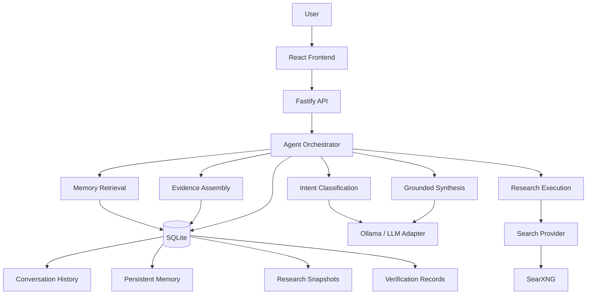
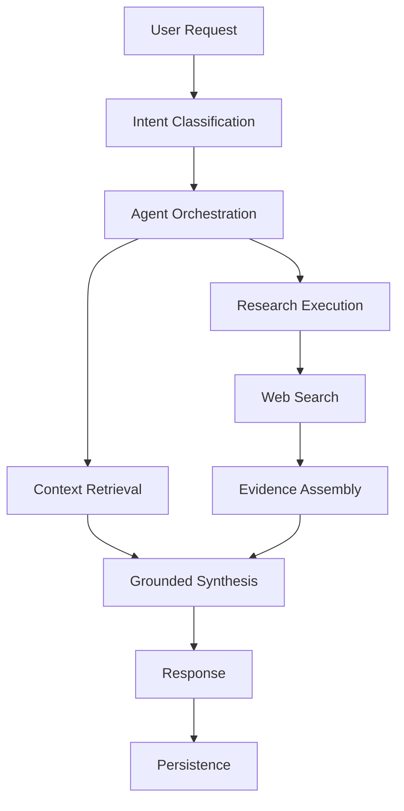
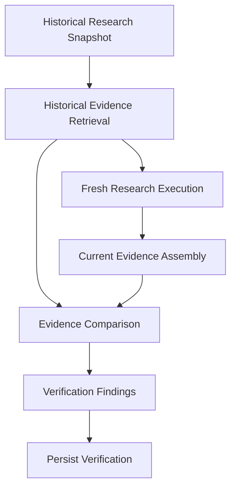

# MiniMi Agent

**A local-first conversational research agent that remembers what it investigated, retrieves evidence, and revisits its conclusions when information changes.**

MiniMi Agent is a conversational research system built around more than a single web search. It combines intent-aware orchestration, web search, persistent conversation and research history, evidence-grounded synthesis, memory retrieval, and temporal verification into a unified interface.

Instead of treating every question as an isolated request, MiniMi can retrieve relevant historical context, conduct research, preserve its findings, and compare previously observed information against fresh evidence.

---

## Overview

Research information doesn't remain static. Product pricing changes. Documentation evolves. Previously accurate answers become outdated.

MiniMi is designed around that problem.

The agent supports four primary request workflows:

| Intent | Purpose |
|---|---|
| `RESEARCH` | Investigate a question using web search and evidence-grounded synthesis. |
| `RECALL` | Retrieve relevant information from previously stored conversations and research context. |
| `VERIFY` | Revisit historical research and evaluate it against newly retrieved evidence. |
| `COMPARE` | Compare remembered information with current research while preserving the distinction between historical and fresh evidence. |

These workflows are coordinated by the agent rather than exposed as isolated utilities.

---

## Core Capabilities

### 1. Web Research

MiniMi integrates a search provider through a normalized search interface.

Search results are assembled into research evidence that can be used during answer synthesis.

The search infrastructure is built around **SearXNG**, allowing the agent to retrieve web results without depending on a proprietary search API as its primary search interface.

### 2. Evidence-Grounded Synthesis

Research responses are generated using assembled evidence rather than treating model-generated statements as independently verified facts.

The synthesis layer supports:

- Evidence-aware answer generation.
- Source attribution through evidence references.
- Structured response validation.
- Handling of conflicting evidence.
- Explicit insufficient-evidence responses.
- Separation between research evidence and generated conclusions.

### 3. Persistent Conversational Memory

MiniMi persists conversations and research context using **SQLite**.

Its memory system supports:

- Conversation history.
- Persistent memory records.
- Memory retrieval.
- Full-text search through SQLite FTS5.
- Retrieval of relevant historical context for agent workflows.

Memory is intended to support useful retrieval rather than simply replaying an entire conversation.

### 4. Temporal Verification

MiniMi can revisit previously stored research and evaluate it against newly retrieved evidence.

The verification workflow includes:

1. Retrieving a historical research snapshot.
2. Executing fresh research.
3. Assembling current evidence.
4. Comparing historical and current evidence.
5. Producing structured verification findings.
6. Persisting verification and comparison results.

Verification distinguishes outcomes such as:

- `unchanged`
- `changed`
- `unsupported`
- `inconclusive`

Missing current evidence is not automatically treated as proof that historical information is wrong.

### 5. Conversation History

Conversation records are persisted and can be retrieved through the application.

The frontend includes a dedicated **History** workspace for browsing and reopening previous conversations.

### 6. Memory Workspace

The application exposes a dedicated **Memory** workspace for exploring retrieved memory information.

### 7. Verification Workspace

The application provides a dedicated interface for examining historical research, verification results, and evidence comparisons.

---

## Architecture

MiniMi uses a modular TypeScript architecture that separates orchestration, model integration, search, evidence processing, persistence, and frontend presentation.

### System Architecture



<sub>Conceptual representation of the system's responsibilities and relationships.</sub>

### Architectural Boundaries

| Component | Responsibility |
|---|---|
| Agent orchestrator | Coordinates intent handling, retrieval, research, evidence processing, and response generation. |
| Intent classifier | Interprets requests and produces structured intent information. |
| Memory retriever | Retrieves relevant historical context. |
| Research executor | Coordinates research execution. |
| Search service | Provides a normalized search interface. |
| SearXNG provider | Integrates with the configured search instance. |
| Evidence assembler | Organizes research results into structured evidence. |
| Grounded synthesizer | Generates responses using supplied evidence. |
| Historical research retriever | Retrieves historical research context for verification workflows. |
| Evidence comparison engine | Compares historical and current evidence. |
| Fresh research verifier | Coordinates fresh research and verification. |
| SQLite repositories | Persist conversations, memory, research, and verification-related data. |

The system uses interfaces and structured contracts to keep major components separated and testable.

---

## Research Lifecycle

A research request follows a coordinated workflow.



The exact execution path depends on the request intent and the available context.

Requests involving historical information may rely on memory retrieval, while research requests may require fresh search execution. Verification and comparison workflows combine historical context with newly retrieved evidence.

---

## Temporal Verification Lifecycle

Temporal verification is one of MiniMi's central capabilities.



The verification process preserves historical research rather than replacing it with the latest observation.

This allows the system to evaluate differences between what was previously observed and what current research supports.

### Verification Outcomes

| Outcome | Meaning |
|---|---|
| `unchanged` | Current evidence continues to support the historical information. |
| `changed` | Current evidence indicates that the historical information has changed. |
| `unsupported` | Historical information is no longer sufficiently supported by available evidence. |
| `inconclusive` | Available evidence is insufficient to determine whether a change occurred. |

### Evidence Comparison Outcomes

| Outcome | Meaning |
|---|---|
| `unchanged` | Historical and current evidence remain consistent. |
| `changed` | Evidence indicates a meaningful difference. |
| `historical_only` | Evidence exists in the historical snapshot but not in the current results. |
| `current_only` | Evidence appears in current research but not in the historical snapshot. |
| `inconclusive` | Available evidence cannot establish a reliable comparison. |

These distinctions help avoid treating missing evidence, conflicting evidence, and actual changes as equivalent situations.

---

## Technology Stack

| Layer | Technology |
|---|---|
| Language | TypeScript |
| Runtime | Node.js 22+ |
| Backend | Fastify |
| Validation | Zod |
| Frontend | React |
| Frontend tooling | Vite |
| Styling | Tailwind CSS |
| LLM integration | Ollama |
| Search | SearXNG |
| Persistence | SQLite |
| Memory search | SQLite FTS5 |
| Testing | Vitest |

---

## Project Structure

The project is organized around modular agent capabilities, infrastructure, persistence, evaluation, and frontend workspaces.

| Area | Responsibility |
|---|---|
| `src/` | Backend application, agent capabilities, infrastructure, and integration logic. |
| `frontend/src/` | React frontend and application workspaces. |
| `frontend/src/components/` | Chat interface and dedicated research, history, memory, and verification workspaces. |
| `tests/` | Backend unit, integration, reliability, architecture, and performance tests. |
| `evaluation/` | Evaluation dataset, fixtures, evaluator, and validation tooling. |
| `docker-compose.yml` | Local SearXNG service orchestration. |
| `searxng-settings.example.yml` | Example SearXNG configuration. |
| `.env.example` | Example backend environment configuration. |

---

## Getting Started

MiniMi is designed to run locally.

### Prerequisites

Install the following before starting:

- Node.js 22 or later.
- npm.
- Docker and Docker Compose.
- Ollama.

The application uses a local model provider and locally operated search infrastructure.

### 1. Clone the Repository

```bash
git clone https://github.com/qwerty12-ai/minimi-agent.git
cd minimi-agent
```

### 2. Install Backend Dependencies

From the repository root:

```bash
npm install
```

### 3. Install Frontend Dependencies

```bash
cd frontend
npm install
cd ..
```

### 4. Configure Environment Variables

Create a local environment file from the provided example:

```bash
cp .env.example .env
```

The example configuration includes:

| Variable | Default | Purpose |
|---|---|---|
| `NODE_ENV` | `development` | Application environment. |
| `HOST` | `127.0.0.1` | Backend host binding. |
| `PORT` | `3000` | Backend API port. |
| `OLLAMA_BASE_URL` | `http://127.0.0.1:11434` | Local Ollama endpoint. |
| `OLLAMA_MODEL` | `qwen3.5:2b` | Configured language model. |
| `OLLAMA_TIMEOUT_MS` | `120000` | Model request timeout. |
| `SEARXNG_BASE_URL` | `http://127.0.0.1:8080` | SearXNG endpoint. |
| `DATABASE_PATH` | `./data/minimi-agent.db` | SQLite database location. |
| `MINIMI_SYNTHESIS_DIAGNOSTICS` | `0` | Optional synthesis diagnostics flag. |

Review the configuration before starting the application.

### 5. Configure SearXNG

Create the SearXNG configuration file from the provided example:

```bash
cp searxng-settings.example.yml searxng-settings.yml
```

The example configuration provides a baseline for a locally operated SearXNG instance.

### 6. Start SearXNG

Start the search infrastructure using Docker Compose:

```bash
docker compose up -d
```

The provided Compose configuration exposes SearXNG on port `8080`.

Check the service status:

```bash
docker compose ps
```

To stop SearXNG:

```bash
docker compose down
```

### 7. Configure Ollama

Install and run Ollama locally.

Pull the model configured in the environment file:

```bash
ollama pull qwen3.5:2b
```

Ensure Ollama is running and accessible at the configured endpoint.

MiniMi uses Ollama as its local LLM provider for structured intent classification and response synthesis.

### 8. Start the Backend

From the repository root:

```bash
npm run dev
```

The backend development script runs the TypeScript application using `tsx` watch mode.

### 9. Start the Frontend

Open a separate terminal:

```bash
cd frontend
npm run dev
```

The frontend development server uses Vite.

The development proxy forwards `/api` and `/health` requests to the backend at `http://127.0.0.1:3000`.

---

## Usage

MiniMi provides several workspaces through its frontend.

### Research

Ask research questions conversationally.

Examples:

- Research the differences between PostgreSQL and MySQL.
- Explain how TypeScript relates to Node.js.
- Find the official documentation for a particular technology.

### History

Browse stored conversations and reopen previous research discussions.

### Memory

Search and inspect previously stored memory information.

### Verification

Revisit historical research and compare it with fresh evidence.

Examples:

- Verify whether a previously researched product is still available.
- Check whether previously recorded pricing has changed.
- Compare historical documentation information with current sources.

---

## API Capabilities

The application exposes API functionality for the primary agent and workspace workflows.

| Capability | Endpoint |
|---|---|
| Agent execution | `POST /api/agent/execute` |
| Agent verification | `POST /api/agent/verify` |
| Conversation listing | `GET /api/conversations` |
| Conversation retrieval | `GET /api/conversations/:id` |
| Research snapshot retrieval | `GET /api/research-snapshots` |
| Memory search | `GET /api/memory/search` |

These endpoints support the frontend's research, history, memory, and verification workflows.

Refer to the implementation for request and response schemas.

---

## Testing

MiniMi includes a test suite covering agent architecture, research workflows, memory retrieval, persistence, verification, evidence assembly, synthesis, search integration, failure recovery, and performance benchmarks.

### Run the Backend Test Suite

```bash
npm run test
```

### Run the Backend TypeScript Build

```bash
npm run build
```

### Run Backend Type Checking

```bash
npm run typecheck
```

### Build the Frontend

```bash
cd frontend
npm run build
```

### Frontend Linting

```bash
cd frontend
npm run lint
```

### Test Coverage Areas

- Agent orchestration.
- Intent classification and routing.
- Research execution.
- Search provider integration.
- Evidence assembly.
- Grounded synthesis.
- Memory schemas and repositories.
- Memory retrieval and full-text search.
- SQLite persistence.
- Historical research retrieval.
- Temporal verification.
- Evidence comparison.
- Agent failure recovery.
- Architecture regression tests.
- Evaluation dataset and evaluator.
- Performance benchmarks.

---

## Evaluation

MiniMi includes an evaluation framework designed to exercise important agent outcomes.

### Evaluation Scenarios

- Direct factual research.
- Multi-source synthesis.
- Insufficient evidence.
- Conflicting research evidence.
- Historical memory retrieval.
- Missing historical information.
- Unchanged historical evidence.
- Changed historical evidence.
- Inconclusive verification.
- Historical memory and current research comparison.

The evaluator assesses structured response characteristics and evidence-related criteria.

Automated evaluation is complemented by semantic review criteria.

> Passing structural checks does not independently establish the factual correctness of every generated response.

---

## Design Decisions

MiniMi prioritizes a modular, local-first agent architecture.

The initial implementation focuses on:

- Agent workflow control.
- Structured intent handling.
- Search infrastructure.
- Persistent context.
- Evidence-grounded synthesis.
- Historical research preservation.
- Temporal verification.
- Reliability and evaluation.

The application is currently designed for local, single-user operation.

Authentication, authorization, multi-user isolation, and multi-tenant SaaS infrastructure are not implemented in the current scope.

The architecture and trade-offs behind these decisions are documented in [`design.md`](./design.md).

---

## Limitations

MiniMi is a research agent, not an infallible source of truth.

- Research quality depends on the search results retrieved and the evidence available.
- Search results may be incomplete, unavailable, or conflicting.
- Verification cannot establish a change when sufficient current evidence is unavailable.
- LLM-generated synthesis may still require human review.
- Automated evaluation does not replace semantic assessment of factual accuracy.
- The current deployment model is local and single-user.
- Multi-user authentication, authorization, and tenant isolation are outside the current implementation scope.

The system is designed to make evidence and uncertainty more explicit, not to eliminate the limitations of web research or language models.

---

## Future Directions

Potential architectural extensions include:

- Multi-user identity and authorization.
- User-level memory and resource isolation.
- Tenant-aware persistence.
- Broader evaluation of research quality.
- Additional search providers.
- More sophisticated evidence and claim analysis.
- Deployment beyond the local environment.

These are possible extensions, not claims about implemented functionality.

---

## Documentation

- [Design Document](./design.md) — Architecture, constraints, and engineering decisions.

---

## License

License information will be added when a project license is selected.