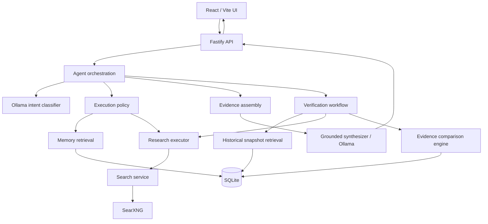

# MiniMi Agent — Design

## Overview

MiniMi Agent is a local-first conversational research agent designed around four request types: **RESEARCH**, **RECALL**, **VERIFY**, and **COMPARE**. Rather than treating every message as a new search, it routes requests through an explicit execution policy, retrieves the appropriate historical or current context, assembles evidence, and asks a local language model to produce a structured, evidence-grounded response.

The challenge's central design problem is temporal and conversational continuity: research should be persisted so that the agent can retrieve what it previously found and assess it against newer search results.

## Architecture

The backend is organized around separable modules and interfaces rather than a single model-driven loop. Fastify exposes the API; the agent layer coordinates classification, planning, retrieval, research, evidence assembly, synthesis and verification. SQLite-backed repositories persist conversations, research snapshots and verification/comparison results. Search and language-model providers are adapters, keeping their integration points distinct from orchestration.

## Request routing and orchestration

The intent classifier uses Ollama and constrained structured output to classify a message into one of four intents. The classification is runtime-validated before the execution policy creates a plan:

| Intent | Memory | Search | Purpose |
|---|---:|---:|---|
| `RECALL` | Required | No | Retrieve previously discussed or stored information |
| `RESEARCH` | No by default | Required | Gather new external information |
| `VERIFY` | Required | Required | Retrieve prior research and investigate it afresh |
| `COMPARE` | Required | Required | Compare historical conversational information with current research |

The execution policy makes these requirements explicit and inspectable. The orchestrator, not the model, owns execution control. Classification is a model-assisted decision; downstream plans and data structures are validated.

## Research and evidence-grounded synthesis

Research is performed through a search-provider abstraction. The current adapter uses SearXNG. The search service validates requests and responses, normalizes result text and URLs, removes duplicate URLs, bounds result counts, and rejects provider identity or query mismatches.

The research executor converts search results into a research context. Evidence assembly combines available memory and research snippets into a normalized evidence package with stable evidence identifiers and source metadata. The grounded synthesizer receives the evidence package and returns a structured response containing the answer, intent, support status and evidence citations.

The synthesis contract distinguishes `supported`, `partially_supported`, and `insufficient_evidence`. Citation references are validated against the supplied evidence. The design explicitly instructs the model not to fabricate citations, historical information, or unsupported conclusions, and to communicate when evidence is inadequate. This is a safeguard and validation boundary, not a guarantee that an LLM can never make an error.

## Persistent conversation and research context

SQLite is the persistence boundary for this local application. Repository abstractions support conversation history and research snapshots, including search query, provider, search/recording timestamps and stored result metadata. Memory search uses SQLite FTS5/BM25 over indexed conversation messages and memory records, with a less restrictive OR-query fallback when an AND query yields no results.

Memory retrieval validates its input and result context. Historical research is retrieved by snapshot identifier and normalized before use; optional conversation association is checked to prevent a snapshot from being used with a mismatched conversation identifier. Persisted snapshots preserve the earlier search results rather than replacing them with a later search.

## Temporal verification and comparison

VERIFY and COMPARE are designed to use history as one side of a temporal investigation rather than relying on the model's recollection alone. The verification workflow retrieves a historical research snapshot and runs fresh research against its query. Verification output is structured into findings with statuses (`unchanged`, `changed`, `unsupported`, or `inconclusive`) and links to historical and current evidence IDs.

The evidence comparison engine also compares snapshots at the result level. It indexes evidence by normalized URL and classifies items as `unchanged`, `changed`, `historical_only`, `current_only`, or `inconclusive`. Matching URLs are considered changed when available result metadata/content fields differ; unmatched URLs are surfaced rather than silently discarded. This is a comparison of captured search-result evidence, not a full-page crawler or a proof of factual truth.

Verification and comparison records are persisted, allowing results to be revisited. The system distinguishes insufficient or inconclusive evidence from a confirmed change.

## Reliability and validation

- Runtime schemas (Zod) validate requests, model output, search data, evidence packages and verification records.
- Search, memory, evidence assembly and verification components expose bounded inputs and typed error paths.
- Search-result processing normalizes and deduplicates URLs and bounds result volume.
- The grounded synthesis contract requires citations to supplied evidence and explicit insufficiency when support is inadequate.
- The test suite covers unit, integration, failure/recovery, boundary, evaluation and regression scenarios across agent orchestration, search, memory, synthesis and verification.

These controls reduce invalid data flow and make failures observable and testable; they do not eliminate model uncertainty or external-search limitations.

## Technology and operating scope

- **Backend:** TypeScript, Node.js, Fastify, Zod
- **Frontend:** React, Vite, Tailwind CSS
- **LLM:** Ollama, through provider interfaces
- **Search:** SearXNG
- **Persistence:** SQLite and FTS5
- **Testing:** Vitest

MiniMi Agent v1 is a locally operated, single-user project. Authentication, authorization, multi-user data isolation and production SaaS deployment are not implemented. This scope prioritizes the agent's research, evidence, memory and temporal-verification behavior within the challenge constraints.

## Performance and Execution Environment

MiniMi Agent uses local LLM inference through Ollama. Consequently,
response latency is influenced not only by the agent's orchestration
and research pipeline, but also by the hardware and inference
configuration on which the application runs.

The development and evaluation environment is a CPU-based laptop
running local model inference. Research requests involving retrieval,
evidence processing, and synthesis may therefore take considerably
longer than they would on a machine equipped with more capable
hardware or accelerated inference.

The observed response time should not be interpreted as a fixed
performance characteristic of MiniMi Agent. End-to-end latency
depends on several factors, including:

- CPU performance and available compute resources
- Memory availability and system load
- Model size and quantization
- Inference configuration and context length
- Search and retrieval latency
- Evidence processing and synthesis workload

The current implementation prioritizes locally executable research,
evidence handling, persistent context, and verification capabilities
within the available development environment.

Performance optimization remains an area for further work. Potential
improvements include profiling individual pipeline stages, reducing
unnecessary inference calls, optimizing prompt and context size,
improving concurrency where appropriate, and evaluating alternative
models and inference configurations.

The current observed latency is specific to the tested environment
and is not a benchmark intended to represent performance across
hardware configurations.

## Tradeoffs and evolution

The local-first stack keeps the project runnable without paid hosted model or search APIs and makes its data and dependencies easier to inspect. SQLite simplifies persistence for a single-user workload; it is not presented as a multi-tenant database strategy. FTS5 provides lexical retrieval rather than embedding-based semantic search. SearXNG reduces dependence on a single commercial search API, while result quality, availability and coverage remain dependent on the configured search engines. Ollama makes model execution local, with quality and latency dependent on the selected model and machine.

A multi-user or hosted evolution would require authentication and authorization enforced at API and repository boundaries, tenant-aware ownership/isolation for conversations, memory, snapshots and verification records, operational controls, deployment/security hardening, and tests for isolation. These are extension points and future work, not capabilities claimed by the current implementation.
